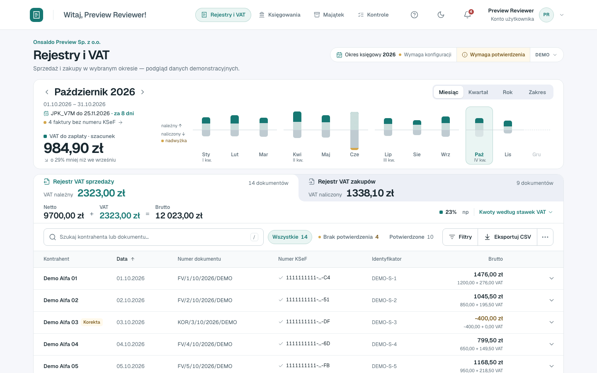
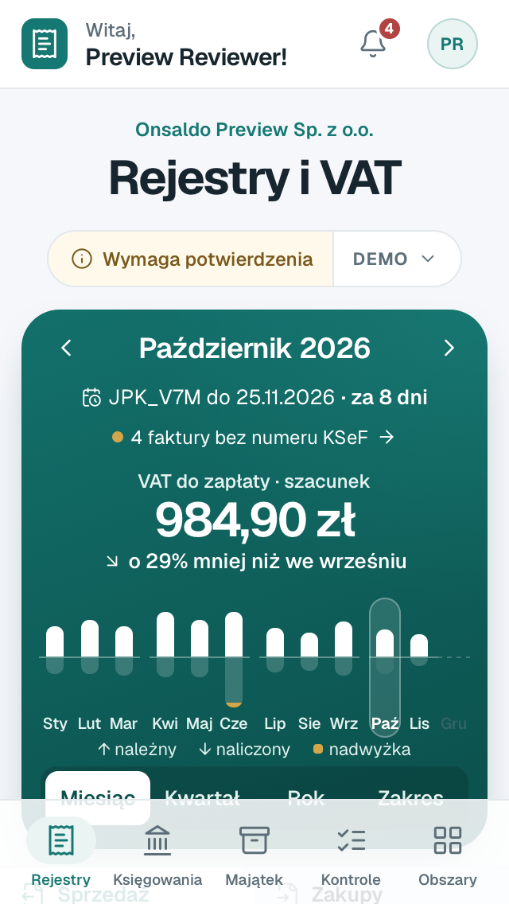
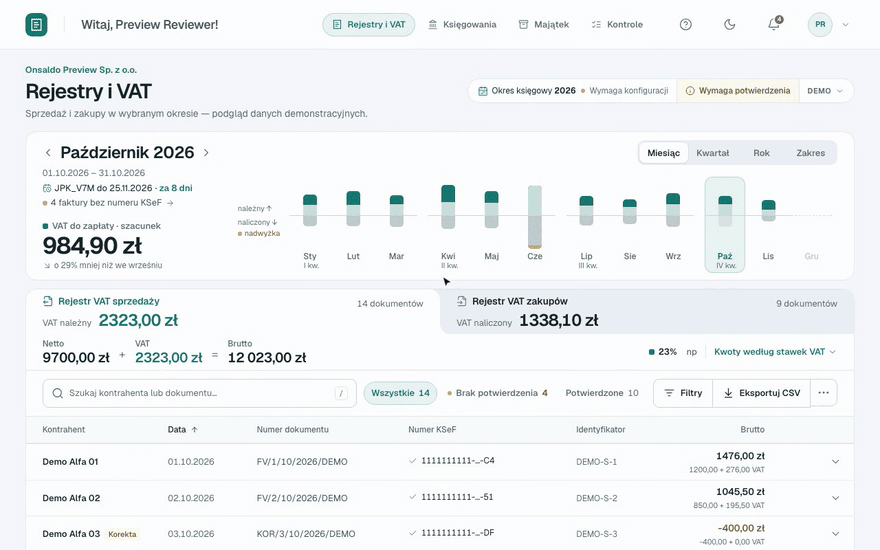

<h1 align="center">Rejestry i VAT</h1>

<p align="center">
  <b>The VAT register of an accounting app, rethought.</b><br>
  Period → register → documents on one screen: what the month comes to, when the JPK is due
  and which invoices still wait for KSeF, from a 1440&nbsp;px desktop down to a 320&nbsp;px iPhone SE.
</p>

<p align="center">
  <a href="https://rejestry-vat-demo.vercel.app/"><b>Open the live demo →</b></a>
  &nbsp;·&nbsp;
  <a href="docs/REQUIREMENTS.md">Every original field and action</a>
  &nbsp;·&nbsp;
  <a href="DESIGN.md">Design system</a>
  &nbsp;·&nbsp;
  <a href="docs/QA.md">Verification</a>
</p>

<p align="center">
  <a href="https://github.com/snowfallen/rejestry-vat-demo/actions/workflows/ci.yml"></a>
  
  
  
  
  
</p>

<p align="center">
  
  
</p>

<p align="center"><sub>
  A working prototype built for a recruitment exercise. The interface is in Polish; all
  records are demonstrative, and no accounting service, KSeF endpoint or external API is connected.
</sub></p>

## Try it in two minutes

- [The register, October 2026](https://rejestry-vat-demo.vercel.app/) — the reference month.
- [Empty register](https://rejestry-vat-demo.vercel.app/?state=empty) and [failed load](https://rejestry-vat-demo.vercel.app/?state=error)
  — the other two data states, straight from the address.
- [A quarter](https://rejestry-vat-demo.vercel.app/?period=2026-Q4) and
  [the purchase register](https://rejestry-vat-demo.vercel.app/?register=purchases).
- Narrow the window down to a phone, or open the demo on one: the period becomes the
  screen's hero and documents open as sheets.

### A 20-second story

Next to the JPK deadline the period says **«4 faktury bez numeru KSeF →»**. Press it: the
list shows exactly those four sales. Open `FV/11/10/2026/DEMO` and press **«Sprawdź status
w KSeF»**: the seal draws its tick, the number appears, and every count on the screen
becomes 3. The check is simulated, and the button says so.



## Goals and where to see them

| Goal                                       | How it is met                                                                                                                        |
| ------------------------------------------ | ------------------------------------------------------------------------------------------------------------------------------------ |
| Clear at first glance                      | One reading order: period → register → documents. The period says what it comes to and when the JPK is due                           |
| Essentials in sight, the rest on request   | Rates, settlement, filters, columns, print and labels open from one control each; nothing extra on the first screen                  |
| Every original field and action kept       | All reference columns, filters, statuses and actions are present; the inventory is in [docs/REQUIREMENTS.md](docs/REQUIREMENTS.md)   |
| Populated, empty and error states          | The **DEMO** badge or `?state=empty` / `?state=error`; the error state retries for real through `GET /api/register`                  |
| Desktop, iPhone SE and every width between | Tested at 1440 to 320 px with no sideways scroll; the phone layout is its own design, not a squeezed table                           |
| Compact filters                            | One **Filtry** panel with counts per option; applied criteria become removable chips                                                 |
| Lists and details that open with care      | A document opens like a receipt under its row, its KSeF seal settling in; month groups fold; motion respects reduced-motion settings |

## Accounting details done right

- The JPK_V7M deadline is the 25th, moved past weekends and Polish public holidays
  (Ordynacja podatkowa, art. 12 § 5).
- The month's return amount is shown in whole złoty (art. 63 § 1), and only for a month:
  a quarter has no return of its own.
- A KSeF number starts with the seller's NIP. Purchases are received through KSeF, so
  they always carry the supplier's number; only sales can wait for one.
- Since February 2026 every invoice in JPK_V7 needs a KSeF number or an OFF, BFK or DI
  marking, hence the note beside the deadline.
- GTU codes mark sales only; the purchase register explains why it has none.
- A correction of a non-taxed (np) sale changes its value, not the VAT.
- The CSV opens in Polish Excel as is (BOM, `;`, decimal comma) and neutralises
  spreadsheet formulas.
- «VAT do zapłaty» is an estimate without a surplus carried over from earlier periods,
  and says so.
- The demo company uses the placeholder NIP `1111111111`; supplier numbers fail the NIP
  checksum on purpose, so none belongs to a real firm.

## Walkthrough

- Read the screen top to bottom: **period → register → documents**.
- Pick the settlement period on the month strip. Each bar is that month's VAT in the
  selected register. Switch between **Miesiąc**, **Kwartał**, **Rok** and **Zakres**;
  `‹ ›` step to the previous or next period across year boundaries. In **Zakres**,
  click the first and last month on the strip or type exact dates; on a phone a
  finger drags the range's edge handles, and a short hold on the highlight picks it up
  to move it (with a light tick where the device allows it).
- Month and quarter show the JPK_V7M filing deadline; a quarter shows the nearest one
  still ahead (the 25th, moved past weekends and Polish public holidays).
- Switch between the sales and purchase registers. Each tab carries its VAT, so both
  are visible at once; the sheet header shows the period's estimated VAT payable
  (or input VAT surplus).
- **Kwoty według stawek VAT** opens the per-rate table and the period settlement.
- Search by contractor, document number, identifier or KSeF number (`/` focuses the
  search; matches are highlighted).
- **Wszystkie / Brak potwierdzenia / Potwierdzone** narrow the list by KSeF status;
  on phones the three views scroll sideways under the search.
- Open **Filtry** for operation, JPK V7, document series and labels. Each option shows
  how many documents it would leave; applied criteria become removable chips.
- Sort by any column from its header; on phones, where documents are cards, the
  **Filtry** sheet sorts them («Sortuj według»).
- Click a row (or its chevron) to open the document as a receipt: net + VAT = gross,
  the VAT share, the KSeF steps, operation, JPK code, series, a copyable identifier,
  a label and a session note.
- An opened document links to all of its contractor's documents of the year
  («13 dokumentów dla Demo Alfa 01 w 2026 →»).
- A waiting sale can be checked in KSeF from its opened document (simulated, and marked
  as demo data).
- Confirmed KSeF documents stay quiet (their number and a small check); only the
  unconfirmed ones are marked, in amber.
- Quarter, year and range views group documents under month headings with totals.
- Export every filtered document to CSV, regardless of pagination.
- **Więcej działań** holds printing, labels and column preferences (and export on
  phones). Reorder columns by dragging headers or in preferences; resize with the
  header grip or its arrow keys.
- The **DEMO** badge explains the demo context and switches the populated, empty and
  error states. Retry keeps the period and filters; an empty month offers the nearest
  month with documents.
- The address keeps the period, register, KSeF view, search and demo state
  (`/?period=2026-Q3&ksef=pending`, `/?state=error`): a reload keeps them and a link
  shares them.
- **Jak to działa?** is a five-step tour on request: the `?` in the header on desktop,
  the account sheet on phones. Nothing starts by itself.

Edits to notes, labels, document series and column layout last for the current
session and reset on refresh. This is intentional: the exercise has no backend.

## Design decisions

The reference's pale canvas, white surfaces, teal accent and amber context are
retained; the structure is new. The two screenshots are one page: the
accounting-area map on top, the register below its "Rejestry i VAT" tab. The
original spent a full screen on the map and stacked a large filter block, a
summary and a table. Here the page follows how an accountant works: the area,
the period, the register, then the documents.

- **The area map as one line.** Area tabs with this register selected and the
  accounting year's status sit above the title; the full map (year card, readiness
  of each area) opens on demand.
- **Period as a year of months.** Year and month selects became one strip that also
  shows the VAT rhythm of the year. One highlight stretches over a month, a quarter,
  the year or a range. Drag it to move the period, or drag across months to draw a
  range; Shift + arrow keys do the same from the keyboard.
- **Registers as tabs that carry numbers.** Sales and purchase VAT are compared
  without switching, with the VAT to pay beside them. The white tab slides to the
  chosen register and flows into the documents.
- **Totals as one equation.** Netto + VAT = Brutto, with the rate split beside it and
  details on request, instead of four separate metric boxes.
- **Filters on demand.** A compact popover (bottom sheet on phones) with live counts;
  applied criteria stay visible as chips. KSeF status, what an accountant chases
  before filing, stays in sight as views with counts.
- **Documents open as documents.** An opened row becomes an invoice sheet: parties,
  amounts adding up line by line, a KSeF seal, and the document's KSeF steps. On a
  phone it grows out of the tapped row as a bottom sheet and folds back into it.
- **A phone that behaves like an app.** The register tabs and the search row stick
  under the header while the list scrolls, the list grows with «Pokaż kolejne», and
  a label change can be undone from its toast.
- **States on the same axis.** Empty, no-results and error pictures are drawn as the
  period strip's VAT axis: waiting, searched over, broken.
- **Light and dark.** The same palette in both themes, all colours as tokens.

The design language is written down in [DESIGN.md](DESIGN.md).

All motion is short, uses the View Transitions API where it helps follow a change,
and switches off under `prefers-reduced-motion`. Native dialogs, radio groups, tabs
and menus keep expected keyboard behaviour; status changes use live regions.

The screenshots do not reveal hidden menus or document details; their contents
were designed independently, as permitted. See
[the coverage matrix](docs/REQUIREMENTS.md) for every original field and action.

## Architecture

Next.js 16 App Router, React 19, TypeScript 5.7 strict, Tailwind CSS 3 and CSS
Modules, PostCSS/Autoprefixer.

```
src/
  app/                         routes only (page, layout, error, not-found, healthz,
                               api/register) and copy.ts for the frame's own text
  features/
    workspace/                 the shell around every accounting area
      components/              app-header/ (notifications, theme toggle), area-nav/,
                               area-tab-bar/ (phone), areas-dialog/, profile-dialog/
      model/                   areas, area icons, organisation
      copy.ts                  Polish copy of the header, areas map and account
      index.ts                 public API of the feature
    register/                  the VAT register screen
      api/                     the data boundary: RegisterSnapshot and its error,
                               demo-store.ts (the backend's stand-in, served by
                               GET /api/register), register-client.ts (fetch)
      model/                   pure domain: no React, no browser APIs
        types.ts labels.ts     vocabulary: column, field, tag and operation names
        period/                periods (labels, bounds), navigation, month names,
                               public holidays, JPK deadlines and countdown
        query.ts               criteria, facets, search, sorting
        amounts.ts             totals, VAT rates, months, settlement
        csv.ts fixtures.ts     export and demo data
        url.ts                 period, register, KSeF view and search in the address
        model.test.ts          Vitest
      state/
        actions.ts             every intent the screen can dispatch (one union)
        reducer.ts             pure state transitions, exhaustive over actions
        selectors.ts           derived data: the listed page, figures, criteria
        use-register.ts        useReducer + memoised selectors + reloads via the API
        *.test.ts              reducer scenarios and selectors (Vitest)
      copy.ts                  every Polish interface string, grouped by section
                               (one KSeF vocabulary, plural forms through helpers)
      components/              one folder per component, each with its index.ts
        register-screen/       layout: area → period → register → documents, with
                               the heading (a server component), title, controls,
                               results and dialogs in their own files
                               and hooks for demo state, notices, CSV and dialogs
        period-picker/         summary, mode switch, range dialog and axis/ («Oś rozliczenia»:
                               scale, month, drag and keyboard hooks)
        register-sheet/        register tabs with their VAT
        register-totals/       Netto + VAT = Brutto and the rate split
        toolbar/ filters/      search, tools menu, filter panel, chips, KSeF views
        documents/             documents-table/, document-cards/, document-cells/,
                               document-details/, document-sheet/, pagination/,
                               register-states/
        dialogs/               columns-dialog/, series-dialog/, tags-dialog/
        guided-tour/           the on-request tour (only the parts on screen)
        context-capsule/       year, VAT context and the demo-state menu
        print-register/
      index.ts
  components/ui/<name>/        generic primitives: Button, Dialog, Collapsible,
                               SegmentedControl, Toast, AnimatedMoney, Avatar, ListOption
                               (their two strings in components/ui/copy.ts)
  hooks/                       useMediaQuery, useDismiss, useCountUp, useTheme,
                               useScrolledPast, useAnchoredPlacement (popovers in view),
                               useSwipeStep (touch swipe to step)
  lib/                         breakpoints (one source for Tailwind and useMediaQuery),
                               format, plural, cx, cssVars, view transitions, clipboard,
                               download, the head boot script
```

Principles:

- **One direction of data.** `useRegister` owns state in a reducer; components get
  values and intent callbacks and never filter or sum documents themselves. Derived
  data comes from pure selectors, memoised with exact dependencies.
- **Copy in one place.** No Polish string lives in a component: interface text is in
  each feature's `copy.ts`; domain names (columns, fields, filters) in `model/labels.ts`,
  months and period names in `model/period/`.
- **Domain separate from UI.** `model/` is plain TypeScript, ready to be shared with
  the planned mobile app. Money is integer grosze throughout.
- **Styling split.** Tailwind for layout, spacing, type and colour tokens (mapped to
  the CSS variables in `globals.css`); a colocated CSS Module only where a component
  needs motion, pseudo-elements or state selectors. Every colour, layer, shadow and the
  header height is a token, so the dark theme is one block of variables. Layout widths
  are the `phone:`, `desk:` and `wide:` variants; long class lists are split with `cx`
  into a base and one argument per variant. A module stays under 300 lines; a part
  that grows gets its own module, and a parent's state reaches it as a `data-*`
  attribute.
- **Reuse before repetition.** Buttons, dialogs, disclosure and dismissal behaviour
  exist once in `components/ui` and `hooks`. A dialog becomes a bottom sheet on
  phones by itself; the document sign is one component for the table and the list.
- **Server where nothing reacts.** `page.tsx` is a server component: it renders the
  static heading (organisation, title, subtitle) and passes it to the interactive
  screen as a prop. Everything below the heading depends on one reducer, so it is
  one client tree.
- **The address is state.** `page.tsx` reads `searchParams` (period, register, KSeF
  view, search) and the reducer starts from them, so the first frame already shows the
  linked state and nothing jumps after hydration. The screen then keeps the address
  in step with `history.replaceState`, so stepping through months does not fill the
  back button. Reading the address makes `/` render per request.
- **Clear boundaries.** A component folder exposes its public parts through
  `index.ts`. Inside a feature imports are relative; between features and to shared
  code they use the `@/` alias and the feature's `index.ts`.

The October 2026 sales reconcile to the reference totals of 9700.00 PLN net,
2323.00 PLN VAT and 12023.00 PLN gross, including a non-taxed −400.00 PLN
correction. The rest of 2026 is generated demo data. The demo's today is 17 November 2026:
December and later periods have not begun and cannot be selected; 2025 holds no
documents, which shows the empty state.
VAT settlement is an estimate (no carried-over surplus) and not a tax calculation.
Whole-złoty amounts round the way tax returns do (from 50 gr up).

## Next steps with a real backend

- **Data from the server — already in place.** The page reads the register on the
  server and hands it to the screen; reloads, the demo states and retry go through
  `GET /api/register` (`?state=empty|error` reproduces the other states, a failed
  request or a lost connection shows the error state). Labels and notes are kept as
  session edits over the served documents. A real backend replaces
  `api/demo-store.ts`; the screen does not change. Next would be paging and filtering
  on the server for registers too large to send whole.
- **KSeF as events.** Confirmations would arrive as events and move a document's
  status and the bell without a reload. The demo's «Sprawdź status w KSeF» is the
  manual form of the same thing; a batch check of every waiting sale would follow.
- **Invoices outside KSeF.** A foreign supplier's invoice has no KSeF number and is
  marked BFK in JPK_V7; the purchase register would show it as «Spoza KSeF», neutral
  rather than a warning.
- **Shared with the mobile app.** `model/` has no React and no browser APIs: periods,
  deadlines, sums, filters and the address format can be shared as they are. Colour
  tokens are plain CSS variables, ready to be exported for React Native.
- **Languages.** Components hold no text: interface copy and domain names live in
  `copy.ts`, `labels.ts` and `period/`, so translation means more of these files, not
  changes in components.
- **For daily work.** Saved filter views, actions on several selected documents and a
  history of each document's changes.

## Run locally

Node 24 LTS and pnpm 10 are recommended. Versions are pinned in `.nvmrc` and
`package.json`; `pnpm-lock.yaml` is committed.

```sh
corepack enable
corepack prepare pnpm@10.34.9 --activate
pnpm install --frozen-lockfile
pnpm dev
```

Open <http://127.0.0.1:3100>.

## Checks

```sh
pnpm format:check
pnpm verify
pnpm exec playwright install chromium webkit
pnpm test:e2e
```

The same browser suite can verify a deployed demo without starting a local server:

```sh
PLAYWRIGHT_BASE_URL=https://your-demo.vercel.app pnpm test:e2e
```

Vitest covers arithmetic, filter combinations, Polish search normalization,
empty periods, CSV escaping and spreadsheet-formula injection. Playwright runs
against the production build in desktop Chromium and iPhone SE-sized WebKit
at 375×667 and 320×568. It covers the core workflows, keyboard/focus, download
contents, print output, required states, overflow and automated accessibility.
Browser emulation is not a claim of testing on a physical iPhone.
See [verification results](docs/QA.md) for the tested scope and limits, and
[SECURITY.md](SECURITY.md) for the content security policy, headers and reporting.

## Deploy to Vercel

Import this repository in Vercel. `vercel.json` explicitly selects Next.js and
runs formatting, types and domain tests before each build. Use Node 24.
No environment variables or application credentials are needed.
For reviewer access, the production URL must open without Vercel Authentication.
Verify that link in a signed-out browser before submission.

The CI workflow runs checks for PRs and `main` on GitHub-hosted runners. Vercel's
Git integration can publish `main` automatically, with its own pre-build checks.
Browser and container checks run separately on GitHub. If production deployment
must wait for every GitHub check, the optional gated job uses the `production` environment:

1. Add `VERCEL_TOKEN`, `VERCEL_ORG_ID` and `VERCEL_PROJECT_ID` as environment secrets.
2. Set the repository variable `VERCEL_CD_ENABLED=true`.
3. If using this gated CD job, disable automatic production deployment from the
   Vercel Git integration so publication only follows a successful verification job.

No credentials are committed. The deployment job stays disabled until configured.

## Docker and Kubernetes

The same source produces a Next.js standalone container for k3s or Kubernetes:

```sh
docker build -t rejestry-vat:local .
docker run --rm --read-only --tmpfs /tmp:rw,noexec,nosuid,size=32m \
  -p 127.0.0.1:3102:3000 rejestry-vat:local
```

The multi-stage runtime runs as UID 1001, exposes `/healthz`, needs no persistent
storage and logs to stdout. Kubernetes manifests use startup/readiness/liveness
probes, resource limits, a read-only filesystem, dropped capabilities, disabled
service-account tokens and rolling updates. No live cluster is used by CI.

```sh
kubectl kustomize infra/k8s
```

Before a real rollout, set an immutable image tag or digest using Kustomize and
provide registry access and a host-specific TLS ingress as appropriate. The
base intentionally does not assume a specific ingress controller, domain or
cluster credentials. See [deployment notes](docs/DEPLOYMENT.md).

## Scope and ownership

Recruitment demo prepared by Oleksandr Bondarenko for evaluation purposes.
No open-source license is granted for the original implementation. Third-party
dependencies retain their own licenses; the supplied identity belongs to its owner.

Implementation references: [Next.js standalone output](https://nextjs.org/docs/app/api-reference/config/next-config-js/output),
[Next.js testing](https://nextjs.org/docs/app/guides/testing),
[Kubernetes security contexts](https://kubernetes.io/docs/tasks/configure-pod-container/security-context/).
